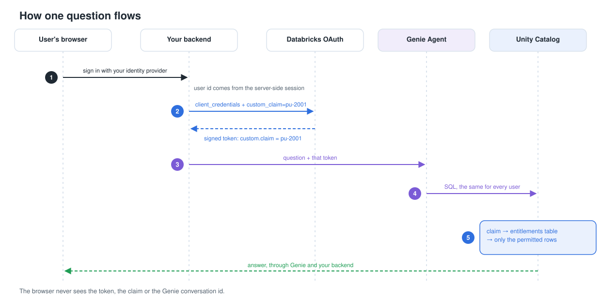
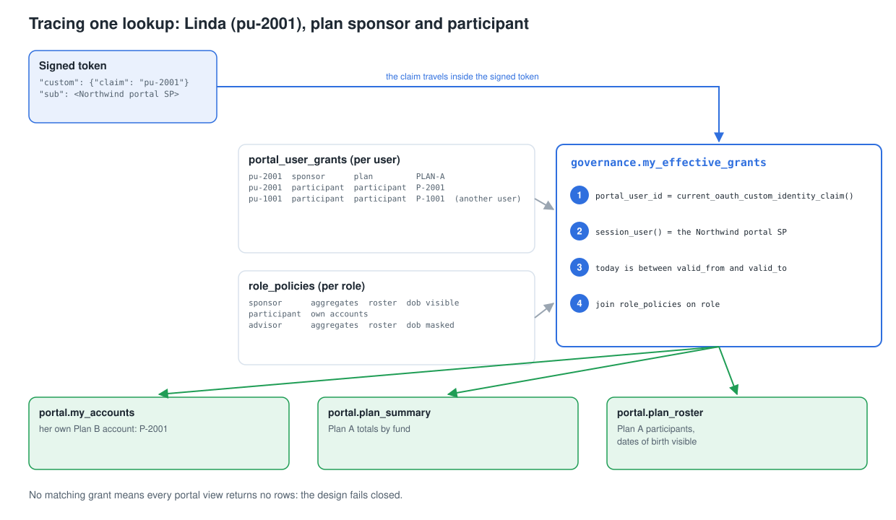
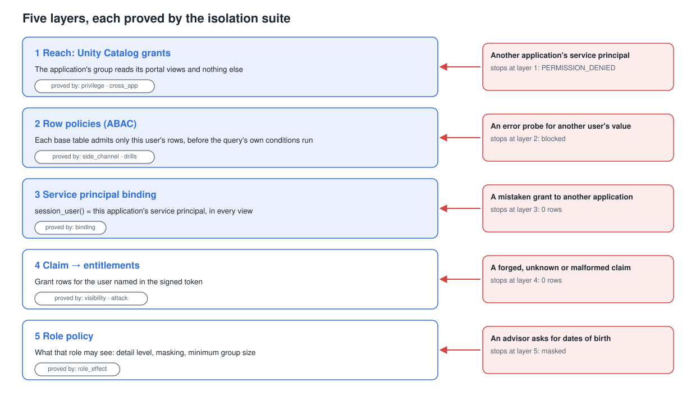
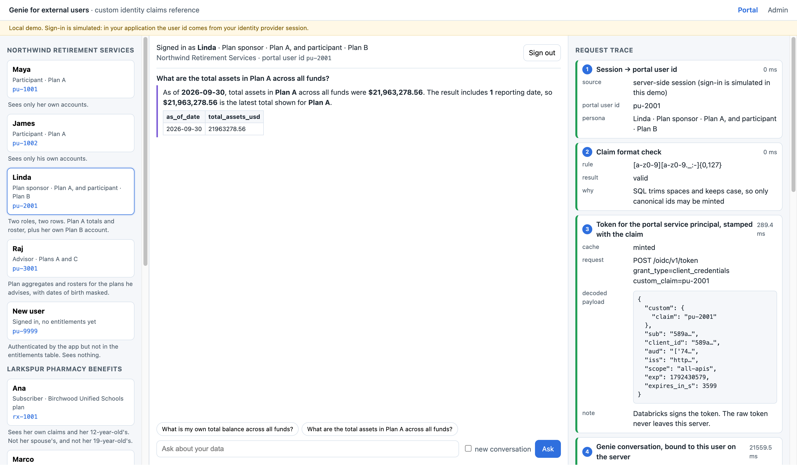
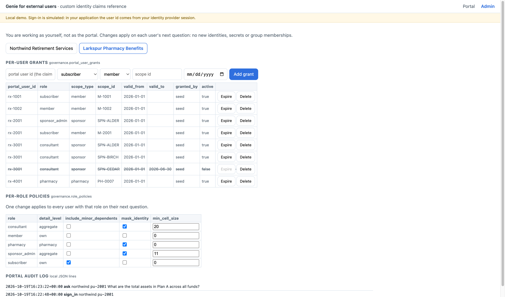

# Genie for External Users with OAuth Custom Identity Claims

A reference framework for serving a Databricks Genie Agent to your application's own users (customers, members, partners) where every user sees only the data their entitlements allow, and none of them needs a Databricks account.

> Community reference, not official Databricks documentation. OAuth custom identity claims are announced on the Databricks *What's coming?* page ([AWS](https://docs.databricks.com/aws/en/release-notes/whats-coming), [Azure](https://learn.microsoft.com/en-us/azure/databricks/release-notes/whats-coming)). Run the availability check below to see whether your workspace has them.

## What this is

Your backend authenticates as one service principal per application. On each request it asks Databricks for a short-lived OAuth token stamped with the signed-in user's id, called a custom identity claim. Databricks signs the token, so it can't be altered. Unity Catalog reads the claim with `current_oauth_custom_identity_claim()` inside dynamic views, compares it to your entitlements table and returns only the rows that user may see. Genie stays free-form: it decides which SQL to write, and Unity Catalog decides which rows come back.

This repo packages the whole pattern: a Databricks Asset Bundle that deploys two synthetic example applications, a Genie Agent for each, an isolation test suite, a local portal and admin app that traces every request step by step, and guides in HTML and PDF.



## Who it's for

- Teams putting "ask your data" into a customer portal or product, where users sign in through their own identity provider.
- Software companies and partners building on Databricks for many customers.
- Teams that today run a service principal per customer, sync every external user, or are tempted to pass the user id in the prompt.
- Anyone who needs per-user **and** per-role access: totals only, masked columns, minimum group sizes, time-bound grants, people with two roles.

## Is it available in my workspace?

Run these in the SQL editor (also in [`sql/check_availability.sql`](sql/check_availability.sql)):

```sql
DESCRIBE FUNCTION current_oauth_custom_identity_claim;
-- A description comes back: available.   [UNRESOLVED_ROUTINE]: not available in this workspace yet.

SELECT current_oauth_custom_identity_claim() AS claim;
-- NULL: available.
-- [OAUTH_CUSTOM_IDENTITY_CLAIM_NOT_PROVIDED]: also available. Your editor session has no claim, and
-- claim-keyed views must be created from a session that carries one (the bundle handles it).
```

The third check is a test token request with `custom_claim` set. See [Step 1 of the Implementation Guide](docs/src/implementation-guide.md#step-1-check-availability); the bundle's first task runs all three checks before it deploys anything.

## What's in the repo

| Path | What it is |
|---|---|
| `databricks.yml`, `resources/` | The bundle: a bootstrap job, one deploy job per example, a teardown job |
| `notebooks/` | Narrated notebooks, one per deploy step (availability, data, entitlements, claim views, grants, Genie Agent, validation) |
| `examples/northwind/`, `examples/larkspur/` | Each example as data: SQL templates, a deterministic generator, personas, expected results and the Genie Agent definition |
| `src/claims_kit/` | Shared library: token minting and caching, Statement API runner, Genie client, deploy logic, isolation suite, request trace |
| `app/` | Local reference app: `/portal` for external users, `/admin` for entitlements |
| `sql/check_availability.sql` | The SQL-editor availability checks |
| `docs/` | Guides (Markdown sources, HTML, PDF), diagrams, screenshots and live-run evidence |
| `tests/` | Offline tests for everything above |

## Quickstart

```bash
git clone https://github.com/AJFR0/genie-external-users-custom-claims && cd genie-external-users-custom-claims
uv venv .venv && uv pip install -e ".[app,docs,dev]" --python .venv/bin/python

# 1. Deploy the bundle. Add --var catalog=<existing catalog> --var create_catalog=false if you can't create catalogs.
databricks bundle deploy -p <profile> --var warehouse_id=<warehouse-id>

# 2. One time, as a workspace admin: a service principal per example application, with an OAuth secret.
databricks bundle run bootstrap -p <profile> --var warehouse_id=<warehouse-id>

# 3. Deploy and validate each example (data, entitlements, claim-keyed views, grants, Genie Agent, isolation suite).
databricks bundle run northwind_deploy -p <profile> --var warehouse_id=<warehouse-id>
databricks bundle run larkspur_deploy -p <profile> --var warehouse_id=<warehouse-id>

# 4. Run the local app against your workspace.
.venv/bin/python scripts/export_local_env.py --profile <profile> --warehouse-id <warehouse-id>
.venv/bin/python -m claims_kit.validate --example northwind
.venv/bin/uvicorn app.main:create_app --factory --port 8765   # open http://127.0.0.1:8765
```

`export_local_env.py` writes a gitignored `.env` with the service principal credentials from the secret scope. Set `APP_REDACT_IDS=true` before sharing your screen.

## The two examples

**Northwind Retirement Services**, a fictional 401(k) recordkeeper (claims `pu-*`):

| Persona | Claim | Pattern | Sees |
|---|---|---|---|
| Maya | `pu-1001` | per-user grant | her own accounts |
| James | `pu-1002` | per-user grant | his own accounts |
| Linda | `pu-2001` | two roles, two rows | Plan A totals and roster, plus her own Plan B account |
| Raj | `pu-3001` | role policy masks a column | aggregates and rosters for Plans A and C, dates of birth masked |
| New user | `pu-9999` | fail closed | nothing |

**Larkspur Pharmacy Benefits**, a fictional pharmacy benefit manager (claims `rx-*`):

| Persona | Claim | Pattern | Sees |
|---|---|---|---|
| Ana | `rx-1001` | relationship rule from data | her claims and her 12-year-old's, not her spouse's or her 19-year-old's |
| Marco | `rx-1002` | adult dependent privacy | his own claims |
| Dana | `rx-2001` | two roles; minimum group size 11 | Alder Manufacturing spend by quarter and drug class, plus her own claims |
| Theo | `rx-3001` | time-bound grant; minimum group size 20 | Alder and Birchwood spend; his Cedar engagement ended, so nothing from Cedar |
| Priya | `rx-4001` | identity masked for a partner | claims at her pharmacy, member ids replaced by a one-way reference |
| New user | `rx-9999` | fail closed | nothing |

All data is synthetic and generated from a fixed seed, so every deploy produces the same numbers.

## Entitlements: per user and per role



Two tables hold every rule. `portal_user_grants` has one row per user, role and scope, with optional start and end dates. `role_policies` has one row per role saying what it may see. One governance view, `my_effective_grants`, is the only object that reads the claim; it keeps the grants for this claim and this application's service principal that are active today and joins them to their role policy. Every portal view joins to it.

Patterns shown in the examples: per-user rows; role policies; several roles per user; relationship rules from data; aggregates with a minimum group size; masking by role; time-bound grants; revoking on the next question; one service principal per application.

## Security in four layers



1. **Unity Catalog grants:** an application's service principal can read only its own portal views.
2. **Service principal binding:** each view checks `session_user()`, so even a mistaken grant to another application returns no rows.
3. **Claim to entitlements:** the user named in the signed token; forged, unknown or malformed claims match nothing.
4. **Role policy:** how much that user's role may see.

## See it run

The portal, signed in as Linda, with every step of one question traced (ids redacted for screen sharing):



The admin console: per-user grants (Theo's expired Cedar grant is struck through) and per-role policies that apply on each user's next question:



## Guides

| Guide | PDF | Source |
|---|---|---|
| Overview: who it is for, what teams did before, what changes | [overview.pdf](docs/pdf/overview.pdf) | [overview.md](docs/src/overview.md) |
| Implementation Guide: availability, deployment, every object, the pattern catalog, backend integration, checklist | [implementation-guide.pdf](docs/pdf/implementation-guide.pdf) | [implementation-guide.md](docs/src/implementation-guide.md) |
| Demo Runbook: a 12-minute script with exact expected numbers | [demo-runbook.pdf](docs/pdf/demo-runbook.pdf) | [demo-runbook.md](docs/src/demo-runbook.md) |

Self-contained HTML versions are in `docs/site/`. Rebuild everything with `.venv/bin/python -m docs.build`.

## What was validated

On a live workspace on 2026-10-19, the isolation suite passed **55 of 55** checks for Northwind and **61 of 61** for Larkspur: per-persona visibility in every view, masking, no-claim and forged-claim attacks, privilege probes, another application's service principal, a mistaken grant, edited and unsigned tokens, and Genie answers checked for the persona's own numbers and nobody else's. The scrubbed results are in [`docs/evidence/`](docs/evidence/).

## Notes and limits

- Use one Genie Agent per request. The announcement lists the Genie Conversation API, the SQL Statement Execution API and the JDBC driver; jobs, notebooks, the SQL editor and dashboards run without a claim, and multi-agent supervisors are not listed.
- Query history attributes queries to the service principal. Keep your own per-user audit log and join it on statement id.
- Genie conversations belong to the service principal. Bind conversation ids to users in your backend.
- Unity Catalog trims spaces around the claim and keeps its case. Validate the format before you mint a token.
- The member-id hash in the Larkspur example is demo grade. Use a keyed hash or a token vault in production.
- Sign-in in the local app is simulated. In your application, the user id comes from your identity provider session.

## License

[Apache-2.0](LICENSE)
