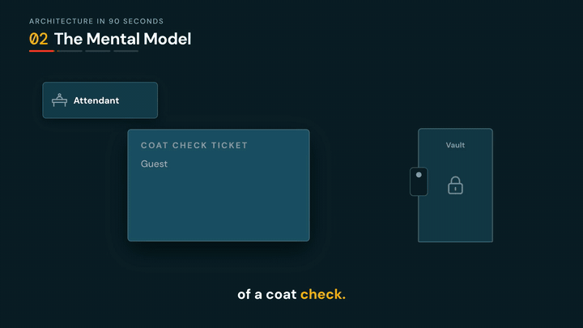
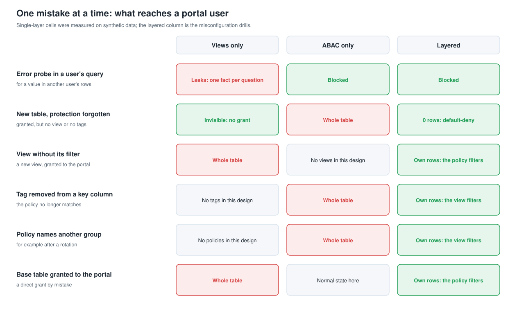

# Genie for External Users with OAuth Custom Identity Claims

**Serve a Genie Agent to your application's own users (customers, members, partners), where each person sees only the data their entitlements allow, nobody needs a Databricks account, and Unity Catalog enforces it in layers.**


> Community reference, not official Databricks documentation. OAuth custom identity claims are announced on the Databricks *What's coming?* page ([AWS](https://docs.databricks.com/aws/en/release-notes/whats-coming), [Azure](https://learn.microsoft.com/en-us/azure/databricks/release-notes/whats-coming)). [Check whether your workspace has them](#is-it-available-in-my-workspace).

## Watch the 90-second explainer



<!-- After publishing: drag the explainer mp4 into this README on github.com, directly below this comment, to embed the full video. -->

## The 30-second version

1. **Your users sign in to your application**, with your own identity provider. Databricks never learns their names, and they never get a Databricks account.
2. **Your backend asks Databricks for a token** for its one service principal, stamped with the signed-in user's id: an OAuth *custom identity claim*. Databricks signs the token, so nobody can change the id.
3. **Genie writes the SQL. Unity Catalog decides the rows.** It reads the claim with `current_oauth_custom_identity_claim()`, looks it up in your entitlement tables, and returns only that user's rows, in two independent layers.


No user sync. No service principal per tenant. No user id in the prompt, where the model could be talked out of it.

## Who it's for

- **Software companies and partners building on Databricks** that want "ask your data" inside their product, for many customers at once.
- **Teams running customer portals** for members, participants, policyholders, patients or account holders, often hundreds of thousands to millions of them.
- **Teams serving partner networks:** brokers, advisors, pharmacies, franchisees, carriers.
- **Anyone who needs more than tenant isolation:** roles, totals only, masked columns, minimum group sizes, time-bound grants, people with two roles.

You'll recognize the need when someone says *"we want Genie in our portal, our users live in Auth0 or Entra External ID, and there are a million of them."*

> **Which Genie?** This serves **Genie Agents through the Genie Conversation API**, called by your backend. The claim also works through the SQL Statement Execution API and JDBC, for your own services and agents. Genie One, the assistant people use inside Databricks, runs as the person signed in to Databricks, so it isn't a path for your application's users.

## Why it holds: five layers


1. **Reach.** Each application's account group can read its own portal views, and nothing else.
2. **Row and mask policies.** Every base table that holds user data carries an ABAC row filter policy, and masked columns a column-mask policy, admitting only what the signed-in user's role may see. Unity Catalog applies them before any condition in the query runs, so a user can't learn about other users' rows through errors. Public reference tables carry a tag instead, so default-deny skips them.
3. **Service principal binding.** Every view checks `session_user()`, so a mistaken grant to another application returns nothing.
4. **Claim to entitlements.** The user named in the signed token. Forged, unknown or malformed claims match nothing.
5. **Role policy.** How much that role may see: own records, totals only, masked columns, minimum group sizes.

### Built to survive mistakes

Claim-keyed views alone stay closed when someone forgets a step, but a user who can shape the SQL, as every Genie question does, can probe other users' rows through errors. ABAC policies alone block those probes, but a missing tag returns the whole table. This repo layers them, then proves it by making each classic mistake on a live deployment:



| Proved on a live workspace | Northwind | Larkspur |
|---|---|---|
| Isolation suite (visibility, roles, constraints, attacks, privileges, other applications, tokens, Genie answers, side channels) | 76 of 76 | 82 of 82 |
| Error probes for other users' values and hidden detail, layered | 5 of 5 blocked | 5 of 5 blocked |
| The same probes against views alone | 4 of 5 leaked | 5 of 5 leaked |
| Misconfiguration drills: users still see only what their role may see | 6 of 6 held | 6 of 6 held |
| ...while one layer alone returned | the whole table or every raw value, every time | the whole table or every raw value, every time |

[Choosing an Enforcement Model](docs/pdf/choosing-an-enforcement-model.pdf) explains the failure modes, the performance cost (about 0.15 to 0.35 seconds per query at 200 million rows), and when a single layer is enough.

## Is it available in my workspace?

Run these in the SQL editor (also in [`sql/check_availability.sql`](sql/check_availability.sql)):

```sql
DESCRIBE FUNCTION current_oauth_custom_identity_claim;
-- A description comes back: available.   [UNRESOLVED_ROUTINE]: not available in this workspace yet.

SELECT current_oauth_custom_identity_claim() AS claim;
-- NULL: available.
-- [OAUTH_CUSTOM_IDENTITY_CLAIM_NOT_PROVIDED]: also available. Your editor session has no claim, and
-- claim-keyed objects must be created from a session that carries one (the bundle handles it).
```

The third check is a test token request with `custom_claim` set. See Step 1 of the [Implementation Guide](docs/pdf/implementation-guide.pdf); the bundle's first task runs all three checks before it deploys anything.

## Quickstart

```bash
git clone https://github.com/AJFR0/genie-external-users-custom-claims && cd genie-external-users-custom-claims
uv venv .venv && uv pip install -e ".[app,docs,dev]" --python .venv/bin/python

# 0. Once per account, an account admin creates the governed tags portal_grain and portal_key (Admin Runbook, step 1).
#    Evaluating without them? Add --var tag_set=stand_in to every bundle command below.

# 1. Deploy the bundle. Add --var catalog=<existing catalog> --var create_catalog=false if you can't create catalogs.
databricks bundle deploy -p <profile> --var warehouse_id=<warehouse-id>

# 2. Once, as a workspace admin: a service principal and an account group per example application.
databricks bundle run bootstrap -p <profile> --var warehouse_id=<warehouse-id>

# 3. Deploy and validate each example: data, entitlements, views, row policies, grants, Genie Agent, isolation suite.
databricks bundle run northwind_deploy -p <profile> --var warehouse_id=<warehouse-id>
databricks bundle run larkspur_deploy -p <profile> --var warehouse_id=<warehouse-id>

# 4. Optional, on a test deployment: the misconfiguration drills.
databricks bundle run northwind_drills -p <profile> --var warehouse_id=<warehouse-id>

# 5. Run the local app against your workspace.
.venv/bin/python scripts/export_local_env.py --profile <profile> --warehouse-id <warehouse-id> --catalog <catalog> --tag-set <governed|stand_in>
.venv/bin/python -m claims_kit.validate --example northwind
.venv/bin/uvicorn app.main:create_app --factory --port 8765   # open http://127.0.0.1:8765
```

`export_local_env.py` writes a gitignored `.env` with the service principal credentials from the secret scope. Pass the catalog you deployed to (`genie_claims_ref` by default) and `--scope` if you changed `secret_scope`. Set `APP_REDACT_IDS=true` before sharing your screen. `--var enforcement=views` deploys the claim-keyed views without row policies; read the enforcement guide before you choose it.

## The two examples

**Northwind Retirement Services**, a fictional 401(k) recordkeeper (claims `pu-*`):

| Persona | Claim | Pattern | Sees |
|---|---|---|---|
| Maya | `pu-1001` | per-user grant | her own accounts |
| James | `pu-1002` | per-user grant | his own accounts |
| Linda | `pu-2001` | two roles, two rows | Plan A totals and roster, plus her own Plan B account |
| Raj | `pu-3001` | role policy masks a column | aggregates and rosters for Plans A and C, dates of birth masked |
| New user | `pu-9999` | no grants | nothing |

**Larkspur Pharmacy Benefits**, a fictional pharmacy benefit manager (claims `rx-*`):

| Persona | Claim | Pattern | Sees |
|---|---|---|---|
| Ana | `rx-1001` | relationship rule from data | her claims and her 12-year-old's, not her spouse's or her 19-year-old's |
| Marco | `rx-1002` | adult dependent privacy | his own claims |
| Dana | `rx-2001` | two roles; minimum group size 11 | Alder Manufacturing spend by quarter and drug class, plus her own claims |
| Theo | `rx-3001` | time-bound grant; minimum group size 20 | Alder and Birchwood spend; his Cedar engagement ended, so nothing from Cedar |
| Priya | `rx-4001` | identity masked for a partner | claims at her pharmacy, member ids replaced by a one-way reference |
| New user | `rx-9999` | no grants | nothing |

All data is synthetic and generated from a fixed seed, so every deploy produces the same numbers.

## Entitlements: per user and per role


Two tables hold every rule. `portal_user_grants` has one row per user, role and scope, with optional start and end dates. `role_policies` has one row per role saying what it may see. One governance view, `my_effective_grants`, reads the claim; it keeps the grants for this claim and this application's service principal that are active today and joins them to their role policy. Every portal view and every row policy function reads it.

Onboarding is an insert, revoking is a delete or an end date, and a role change applies to everyone with that role on their next question. Patterns shown in the examples: per-user rows; role policies; several roles per user; relationship rules from data; precomputed totals for roles that see only totals, with a minimum group size; masking by role in a column-mask policy; time-bound grants; one service principal per application.

## See it run

The portal, signed in as Linda, with one question traced step by step: the SQL Genie wrote, the two grants her claim resolved to, and the row-policy layer underneath (ids redacted for screen sharing):


The admin console: per-user grants (Theo's expired Cedar grant is struck through) and per-role policies that apply on each user's next question:


## FAQ

**Can the model be talked into showing someone else's data?** No. The model writes SQL; it never decides whose data it is. The user id travels inside a token Databricks signs, and Unity Catalog filters every query by it.

**What happens if someone misconfigures it?** That's what the layers are for. A missing tag, a policy aimed at the wrong group, a view written without its filter, a new untagged table, a stray grant or an unfiltered view over a masked column each leaves every user with only what their role may see. The drills prove each one live.

**Can the claim carry roles or a list of plans?** The claim is one string. Keep it an opaque user id, and keep roles and scopes in the entitlement tables: changes apply on the next question without reissuing tokens, and every rule lives in one place you can audit.

**Does it scale to millions of users and thousands of tenants?** Users and tenants are rows in your tables, so onboarding stays an insert. Cluster the protected tables on the columns the policies filter by; the entitlement lookup then prunes files, so a scoped user reads only the files that hold their rows.

**Why not a service principal per tenant, or syncing users?** Per-tenant identities don't express roles inside a tenant, and synced users run into identity limits and lifecycle work. The [Overview](docs/pdf/overview.pdf) compares the earlier patterns.

**Does this work without Genie?** Yes. Your own services and agents can query the same views through the Statement Execution API or JDBC with the same tokens.

## Guides

| Guide | For | Read it |
|---|---|---|
| Solution Brief: the problem, the two locks and what we proved, in plain terms | decision makers, customers | [PDF](docs/pdf/solution-brief.pdf) |
| Overview: who it's for, what teams did before, what changes | everyone | [PDF](docs/pdf/overview.pdf) |
| Choosing an Enforcement Model: views, ABAC or layered, with live failure results and performance | architects | [PDF](docs/pdf/choosing-an-enforcement-model.pdf) |
| Implementation Guide: availability, deployment, every object, the pattern catalog, backend integration, checklist | builders | [PDF](docs/pdf/implementation-guide.pdf) |
| Admin Runbook: governed tags, groups, adding a table, guardrail queries, drills, troubleshooting | operators | [PDF](docs/pdf/admin-runbook.pdf) |
| Demo Runbook: a 14-minute script with exact expected numbers | presenters | [PDF](docs/pdf/demo-runbook.pdf) |

Self-contained HTML versions are in `docs/site/`. The sources in `docs/src/` are templates that pull in the real SQL, diagrams, expected numbers and live evidence; rebuild everything with `.venv/bin/python -m docs.build`.

## What's in the repo

| Path | What it is |
|---|---|
| `databricks.yml`, `resources/` | The bundle: bootstrap, one deploy job and one drills job per example, teardown |
| `notebooks/` | Narrated notebooks, one per step: availability, data, entitlements, views, row policies, grants, Genie Agent, validation, drills |
| `examples/northwind/`, `examples/larkspur/` | Each example as data: SQL templates, row policies, a deterministic generator, personas, expected results, error probes, the Genie Agent definition |
| `config/tags.yml` | The governed tags the row policies use, and the evaluation stand-in set |
| `src/claims_kit/` | Shared library: tokens, Statement API runner, Genie client, deploy, tags and policies, isolation suite, drills, request trace |
| `app/` | Local reference app: `/portal` for external users, `/admin` for entitlements |
| `sql/check_availability.sql` | The SQL-editor availability checks |
| `docs/` | Guides (sources, HTML, PDF), diagrams, screenshots and live-run evidence |
| `tests/` | Offline tests for everything above |

## What was validated

On a live workspace on 2026-10-20, with the layered default and the stand-in tag set:

- **Isolation suite:** 76 of 76 checks for Northwind and 82 of 82 for Larkspur. That covers the deployed policies matching the enforcement model, per-persona visibility in every view with no duplicated rows, masking, CHECK constraints, no-claim and forged-claim attacks, privilege probes, another application's service principal, a mistaken grant, edited and unsigned tokens, Genie answers containing the persona's own numbers and nobody else's, and side-channel probes.
- **Views-only mode, same data:** 9 of the 10 error probes leaked.
- **Drills:** all twelve held, including the two that read a masked or precomputed value through an unfiltered view.

Every result records the reason it passed; the scrubbed results are in [`docs/evidence/`](docs/evidence/).

## Notes and limits

- Use one Genie Agent per request. The announcement lists the Genie Conversation API, the SQL Statement Execution API and the JDBC driver; jobs, notebooks, the SQL editor and dashboards run without a claim, and multi-agent supervisors are not listed.
- Query history attributes queries to the service principal. Keep your own per-user audit log and join it on statement id.
- Genie conversations belong to the service principal. Bind conversation ids to users in your backend.
- Unity Catalog trims spaces around the claim and keeps its case. Validate the format before you mint a token.
- Row policy functions may read only tables without a policy of their own, so the rules' inputs live in an unprotected governance schema that nothing grants to the portal.
- The member-id hash in the Larkspur example is demo grade. Use a keyed hash or a token vault in production.
- Sign-in in the local app is simulated. In your application, the user id comes from your identity provider session.

## License

[Apache-2.0](LICENSE)
